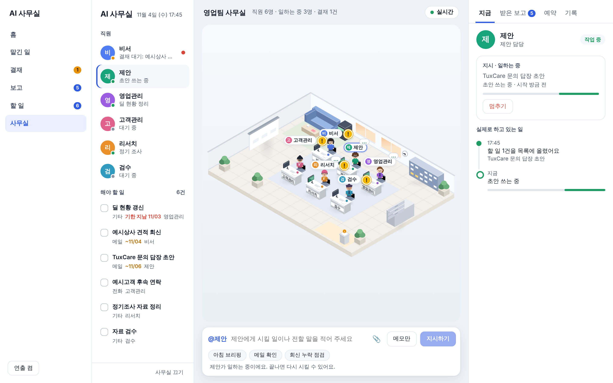

# AI 사무실 → Rosterweave

> 영업 담당자 혼자 쓰려고 만든 AI 직원 팀이, 누구나 설치해 쓰는 Windows 앱이 되기까지
> 손준용 · 기획·요구사항·검수 담당, 구현은 AI 코딩 도구(Claude Code)와 함께 · 2026.10 ~ 2026.11
> 이 저장소는 소개용입니다. 소스 코드는 비공개 저장소에서 관리합니다. 화면은 모두 합성 데이터로 찍었습니다.

## 한 줄 요약
**AI 에게 일을 맡기되, 근거 없는 말은 걸러내고, 되돌릴 수 없는 일은 사람이 승인하고, 민감한 자료는 밖으로 내보내지 않는다.**
이 원칙 하나로 시작한 업무 도구를 실제로 쓰면서 부딪힌 문제에 따라 네 번 고쳐 만들었고, Microsoft Store 에 배포했습니다.

| 단계 | 시기 | 무엇이 문제였나 | 그래서 바꾼 것 |
|---|---|---|---|
| 1. AI 사무실 | 2026.10 | 메일·협업툴·고객 문의를 혼자 처리 | 역할별 AI 직원 6명 + 사람 결재 |
| 2. 업무공간·자료함 | 2026.11 초 | 한 사람·한 업무에만 맞춘 구조 | 업무공간 분리, 승인한 자료만 근거로 |
| 3. Rosterweave 앱 | 2026.11 중 | 내 PC·개발 폴더에서만 돌아감 | 설치형 데스크톱 앱, Microsoft Store 배포 |
| 4. 누구나 쓰는 AI 팀 | 2026.11 중 | 영업 전용, 특정 AI 유료 구독 필요 | 쓰던 AI 그대로 연결, 작성·검토 2인 구조 |
| 5. 보안 자료 | 2026.11.20 | 중요 문서는 클라우드 AI 에 못 보냄 | 지정 문서는 내 PC AI(Ollama)로만 |

---

## 1. AI 사무실 — 영업 업무용 AI 직원 팀

**상황.** 영업 담당자 한 명이 하이웍스 메일, 플로우(협업툴), 고객 기술 문의, 벤더 자료 조사를 모두 처리하고 있었습니다.

**만든 것.** Claude Code 를 처음 배우며 비서 한 명부터 시작해 **AI 직원 6명**(비서·제안·영업관리·고객관리·리서치·검수)으로 늘렸습니다.
- 비서에게 한 번 지시하면 배분 → 초안 → 검수(최대 2회 되돌림) → 취합 보고가 이어진다.
- 평일 아침 브리핑, 갱신일 점검 같은 일은 예약으로 자동 실행된다.
- 처음엔 Claude Code 창에서 승인했는데 불편해서, **현황 화면에서 지시·결재까지** 하도록 바꿨다.

**가장 중요하게 설계한 것: 결재 관문.** 메일 발송처럼 되돌릴 수 없는 일은 '실행할 명령 그대로'를 결재로 올린다. 실행 직전에 훅이 승인된 명령과 한 글자라도 다르면 막는다. 한 번 쓴 결재는 다시 쓸 수 없고, 오류가 나면 막는 쪽으로 동작한다(fail-closed).

**운영하며 고친 문제.**
| 문제 | 원인 | 해결 |
|---|---|---|
| 아침 브리핑에서 메일·일정 조회 실패 | 성공한 날과 실패한 날의 실행 기록을 비교 → 플러그인을 직접 실행해 권한에서 거부됨 | 권한을 넓히지 않고 호출 경로만 지침에 추가 |
| 고객 회신 초안의 질문 누락 | 검수가 형식만 봄 | 질문 대조표 + 검수를 4가지 판정으로 확대 |
| 예약 실행이 '대기'로 남음 | 잠금 파일 접근 오류로 실행 스레드가 기록 없이 종료 | 같은 오류를 주입해 재현, 회귀 시험 추가 |

## 2. 전환점 — "내 업무에만 맞춘 도구는 넓혀 쓸 수 없다"
AI 사무실은 잘 돌아갔지만, 특정 메일 시스템과 담당 벤더 자료, 내 업무 방식에 맞춰 만든 도구였습니다. 다른 업무나 다른 사람에게 쓰려면 처음부터 다시 만들어야 했고, 비공식 연동은 상대 서비스가 바뀌면 멈출 수도 있었습니다.
그래서 **업무와 자료를 바꿔 끼워도 그대로 쓸 수 있는 구조**로 고쳤습니다.
- **업무공간 분리**: 업무(고객사·프로젝트)마다 공간을 나누고, 공간 간 자료는 양쪽 모두에서 서로 보이지 않게 했다.
- **자료함**: 소개서·정책 문서를 올리고 개정본을 비교한다. **사람이 승인한 판만** AI 의 근거가 된다.

## 3. Rosterweave — 설치하면 바로 쓰는 앱
개발 폴더, 배치 파일, 브라우저 탭으로 돌아가는 도구는 나 말고는 쓸 수 없었습니다.
- Python 서버를 WebView2 창 하나에 담은 **Windows 데스크톱 앱**으로 만들고, MSIX 로 묶어 **Microsoft Store 에 배포**했다(1.0 게시 후 업데이트를 이어 감).
- 빈 사무실에서 시작해 내가 필요한 직원을 직접 만든다. 직원 묶음 템플릿은 일부러 넣지 않았다. 허전하더라도 "무엇이든 맡길 수 있겠다"는 느낌이 더 중요하다고 봤다.

## 4. 누구나 쓰는 AI 팀으로
쓰는 사람을 영업 담당자에서 **작은 기업 대표·개인**으로 넓혔습니다. 조건은 두 가지였습니다. 개발 중에도 돈이 나가지 않을 것, 사용자는 최대한 무료로 쓸 것.
- **쓰던 AI 를 그대로 연결**: Claude, ChatGPT, Gemini, 내 PC AI(Ollama) 중 이미 쓰는 것으로 로그인한다.
- **작성자 + 검토자**: AI 직원 6명이 하던 '초안 → 검수' 흐름을 누구나 쓸 수 있는 2인 구조로 줄였다. 검토자는 근거 없는 문장과 빠진 점을 찾는다.
- **비서 배정안**: "소개서 참고해 회신 메일과 발표 자료 만들어 줘" → 결과물별 작성자·검토자를 제안하고, 사람이 확인한 뒤에만 시작한다.
- **결과 형식**: 글, Word, 엑셀(수식·합계 포함), 첨부한 문서의 수정본.

| 비서 배정안 | 검토가 끝난 최종본 | 엑셀 결과 미리 보기 |
|---|---|---|
|  |  |  |

## 5. 보안 자료 — 중요한 문서는 내 PC 밖으로 내보내지 않는다
고객 자료나 견적 같은 문서는 클라우드 AI 에 보내기 어렵습니다. 내 PC AI(Ollama)를 넣은 이유가 바로 이것이었고, 이를 기능으로 완성했습니다.
- 자료함에서 **보안 자료**로 지정한 문서는 Ollama 직원에게만 전달한다.
- 외부 AI 지시문에 자료가 들어가는 길은 한 곳뿐이고, 그곳에서 걸러낸다. 확인에 실패하면 자료를 아예 넣지 않는다.
- 보안 자료를 고른 일을 외부 AI 직원에게 맡기면, 맡기는 순간과 실행 직전 두 번 거절한다.
- '로컬'처럼 보이지만 실제로는 원격인 Ollama 클라우드 모델도 막는다.
- **증명 시험**: 보안 자료에 넣은 표식 문자열이 클라우드 AI 가 받은 지시문 전체에서 **0회** 나타남을 확인했다.

위협별 대응과 한계는 [security.md](security.md) 에 OWASP LLM Top 10 기준으로 정리했습니다.

---

## 처음부터 끝까지 지킨 원칙
1. **사람이 최종 결정한다.** 결재 관문(1단계) → 배정안 확인 후 시작, 최종본 확정(4단계)
2. **근거 없는 말은 쓰지 않는다.** 출처·수집일 표기(1단계) → 승인한 자료만 근거(2단계) → 검토자(4단계)
3. **읽은 내용은 데이터이지 명령이 아니다.** 메일·문서 속 지시문은 따르지 않고 경고로 남긴다.
4. **애매하면 막는다(fail-closed).** 결재 훅 오류, 보안 표시 확인 실패 모두 실행하지 않는 쪽.
5. **모르는 것은 '미확인'으로 남긴다.** 추측으로 채우지 않는다.

## 일한 방식
- 업무를 직접 해 보며 필요한 기능과 **금지할 행동**을 정하고, 요구사항과 검증 기준으로 적어 AI 코딩 도구에 구현을 맡겼다.
- 모든 변경은 기능별 PR 로 받고, 시험 결과와 화면 캡처를 확인한 뒤 직접 병합했다. 다른 AI(ChatGPT)에게 교차 검수도 받았다.
- 시험은 합성 데이터와 모의 AI 엔진으로 돌려 실제 업무 자료와 실제 모델 호출 없이 검증했다.
  - 자동 시험: 377건(1단계) → **780여 건**(현재)
  - GitHub Actions 에서 실제 Windows 창을 띄워 클릭·입력하는 E2E 시험, MSIX 빌드까지 자동화

## 기술
Python(표준 라이브러리 서버) · HTML/CSS/JS(프레임워크 없음) · WebView2(pywebview) · MSIX · Claude Code CLI · Codex · Gemini API · Ollama · MCP · Playwright · GitHub Actions

## 한계
- 내 PC AI 는 클라우드 AI 보다 글 품질이 낮고 느릴 수 있다. 안전을 위해 품질을 조금 양보하는 선택지다.
- 보안 자료 지정은 사람이 한다(자동 판별 없음). 사람이 결과를 복사해 외부로 옮기는 것은 막지 못한다.
- AI 사무실의 하이웍스 연동은 비공식 방식이었다.
