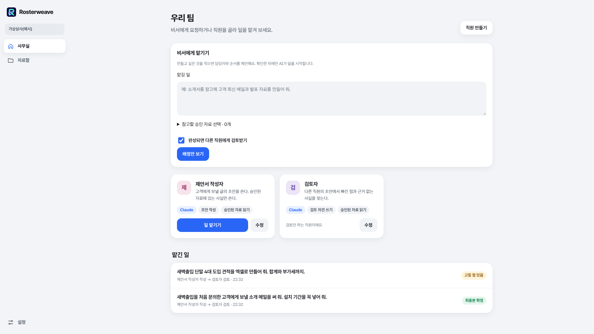
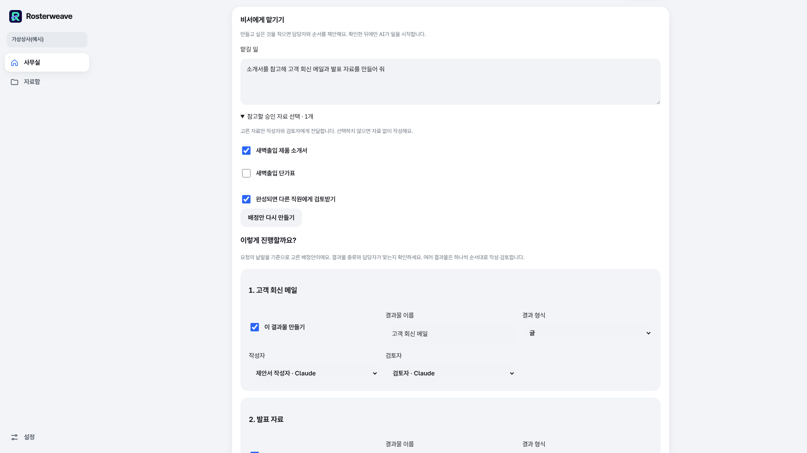
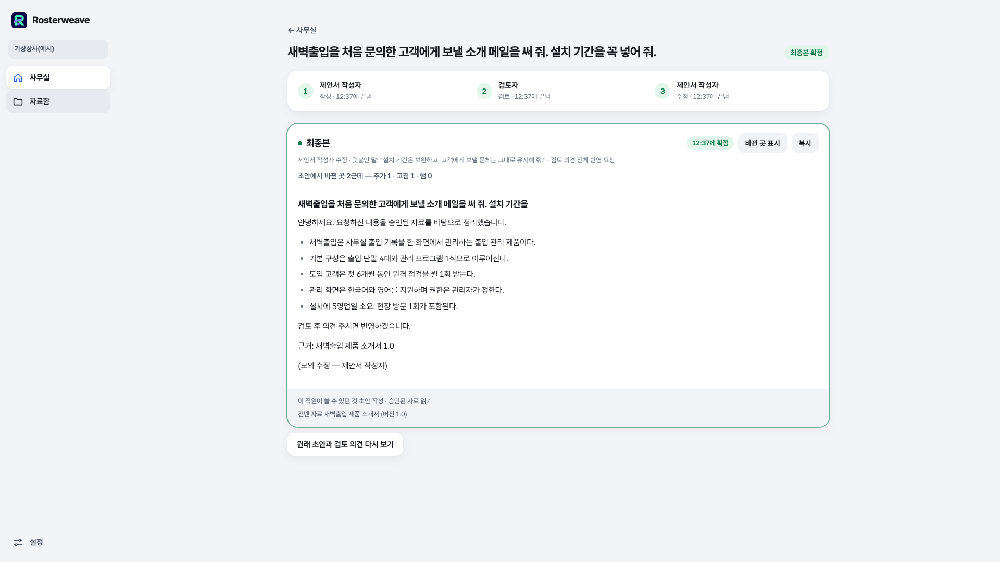
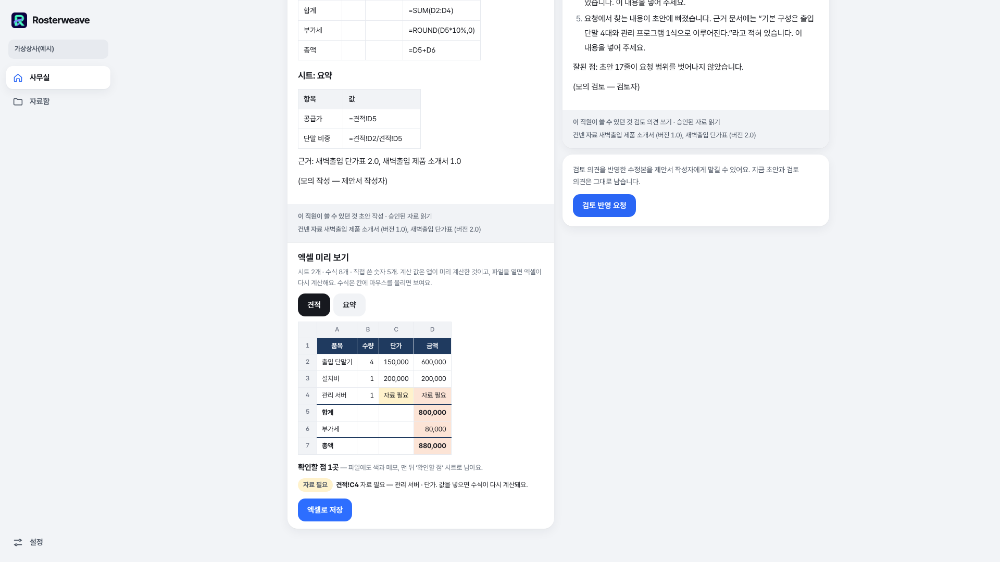
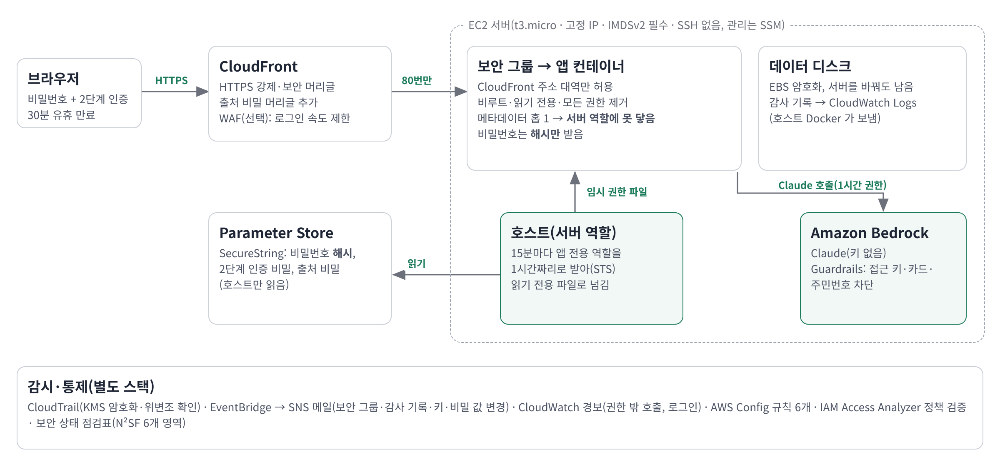

# AI 사무실 → Rosterweave

> 영업 담당자 혼자 쓰려고 만든 AI 직원 팀이, 누구나 설치해 쓰는 Windows 앱과 AWS 개인 서버가 되기까지
> 손준용 · 기획·요구사항·검수 담당, 구현은 AI 코딩 도구(Claude Code)와 함께 · 2026.10 ~ 운영 중
> 이 저장소는 소개용입니다. 소스 코드는 비공개 저장소에서 관리합니다. 화면은 모두 합성 데이터로 찍었습니다.

## 한 줄 요약
**AI 에게 일을 맡기되, 근거 없는 말은 걸러내고, 되돌릴 수 없는 일은 사람이 승인하고, 민감한 자료는 밖으로 내보내지 않는다.**
이 원칙 하나로 시작한 업무 도구를 실제로 쓰면서 부딪힌 문제에 따라 다섯 번 고쳐 만들었고, Microsoft Store 에 배포한 뒤 AWS 개인 서버로도 올렸습니다.

| 단계 | 시기 | 무엇이 문제였나 | 그래서 바꾼 것 |
|---|---|---|---|
| 1. AI 사무실 | 2026.10 | 메일·협업툴·고객 문의를 혼자 처리 | 역할별 AI 직원 6명 + 사람 결재 |
| 2. 업무공간·자료함 | 2026.11 초 | 한 사람·한 업무에만 맞춘 구조 | 업무공간 분리, 승인한 자료만 근거로 |
| 3. Rosterweave 앱 | 2026.11 중 | 내 PC·개발 폴더에서만 돌아감 | 설치형 데스크톱 앱, Microsoft Store 배포 |
| 4. 누구나 쓰는 AI 팀 | 2026.11 중 | 영업 전용, 특정 AI 유료 구독 필요 | 쓰던 AI 그대로 연결, 작성·검토 2인 구조 |
| 5. 보안 자료 | 2026.11 | 중요 문서는 클라우드 AI 에 못 보냄 | 지정 문서는 내 PC AI(Ollama)로만 |
| 6. AWS 서버 | 2026.11 ~ 운영 중 | 밖에서도 쓰려고 서버를 올렸는데 비밀번호·권한 관리에 문제가 있었음 | 2단계 인증, 컨테이너 권한 분리, N²SF 기준 점검 |

---

## 1. AI 사무실 — 영업 업무용 AI 직원 팀

**상황.** 영업 담당자 한 명이 하이웍스 메일, 플로우(협업툴), 고객 기술 문의, 벤더 자료 조사를 모두 처리하고 있었습니다.

**만든 것.** Claude Code 를 처음 배우며 비서 한 명부터 시작해 **AI 직원 6명**(비서·제안·영업관리·고객관리·리서치·검수)으로 늘렸습니다.
- 비서에게 한 번 지시하면 배분 → 초안 → 검수(최대 2회 되돌림) → 취합 보고가 이어진다.
- 평일 아침 브리핑, 갱신일 점검 같은 일은 예약으로 자동 실행된다.
- 처음엔 Claude Code 창에서 승인했는데 불편해서, **현황 화면에서 지시·결재까지** 하도록 바꿨다.

**가장 중요하게 설계한 것: 결재 관문.** 메일 발송처럼 되돌릴 수 없는 일은 '실행할 명령 그대로'를 결재로 올린다. 실행 직전에 훅이 승인된 명령과 한 글자라도 다르면 막는다. 한 번 쓴 결재는 다시 쓸 수 없고, 오류가 나면 막는 쪽으로 동작한다(fail-closed).

**운영하며 고친 문제.**
| 문제 | 원인 | 해결 |
|---|---|---|
| 아침 브리핑에서 메일·일정 조회 실패 | 성공한 날과 실패한 날의 실행 기록을 비교 → 플러그인을 직접 실행해 권한에서 거부됨 | 권한을 넓히지 않고 호출 경로만 지침에 추가 |
| 고객 회신 초안의 질문 누락 | 검수가 형식만 봄 | 질문 대조표 + 검수를 4가지 판정으로 확대 |
| 예약 실행이 '대기'로 남음 | 잠금 파일 접근 오류로 실행 스레드가 기록 없이 종료 | 같은 오류를 주입해 재현, 회귀 시험 추가 |

## 2. 전환점 — "내 업무에만 맞춘 도구는 넓혀 쓸 수 없다"
AI 사무실은 잘 돌아갔지만, 특정 메일 시스템과 담당 벤더 자료, 내 업무 방식에 맞춰 만든 도구였습니다. 다른 업무나 다른 사람에게 쓰려면 처음부터 다시 만들어야 했고, 비공식 연동은 상대 서비스가 바뀌면 멈출 수도 있었습니다.
그래서 **업무와 자료를 바꿔 끼워도 그대로 쓸 수 있는 구조**로 고쳤습니다.
- **업무공간 분리**: 업무(고객사·프로젝트)마다 공간을 나누고, 공간 간 자료는 양쪽 모두에서 서로 보이지 않게 했다.
- **자료함**: 소개서·정책 문서를 올리고 개정본을 비교한다. **사람이 승인한 판만** AI 의 근거가 된다.

## 3. Rosterweave — 설치하면 바로 쓰는 앱
개발 폴더, 배치 파일, 브라우저 탭으로 돌아가는 도구는 나 말고는 쓸 수 없었습니다.
- Python 서버를 WebView2 창 하나에 담은 **Windows 데스크톱 앱**으로 만들고, MSIX 로 묶어 **Microsoft Store 에 배포**했다(1.0 게시 후 업데이트를 이어 감).
- 빈 사무실에서 시작해 내가 필요한 직원을 직접 만든다. 직원 묶음 템플릿은 일부러 넣지 않았다. 허전하더라도 "무엇이든 맡길 수 있겠다"는 느낌이 더 중요하다고 봤다.

## 4. 누구나 쓰는 AI 팀으로
쓰는 사람을 영업 담당자에서 **작은 기업 대표·개인**으로 넓혔습니다. 조건은 두 가지였습니다. 개발 중에도 돈이 나가지 않을 것, 사용자는 최대한 무료로 쓸 것.
- **쓰던 AI 를 그대로 연결**: Claude, ChatGPT, Gemini, 내 PC AI(Ollama) 중 이미 쓰는 것으로 로그인한다.
- **작성자 + 검토자**: AI 직원 6명이 하던 '초안 → 검수' 흐름을 누구나 쓸 수 있는 2인 구조로 줄였다. 검토자는 근거 없는 문장과 빠진 점을 찾는다.
- **비서 배정안**: "소개서 참고해 회신 메일과 발표 자료 만들어 줘" → 결과물별 작성자·검토자를 제안하고, 사람이 확인한 뒤에만 시작한다.
- **결과 형식**: 글, Word, 엑셀(수식·합계 포함), 첨부한 문서의 수정본.

| 비서 배정안 | 검토가 끝난 최종본 | 엑셀 결과 미리 보기 |
|---|---|---|
|  |  |  |

## 5. 보안 자료 — 중요한 문서는 내 PC 밖으로 내보내지 않는다
고객 자료나 견적 같은 문서는 클라우드 AI 에 보내기 어렵습니다. 내 PC AI(Ollama)를 넣은 이유가 바로 이것이었고, 이를 기능으로 완성했습니다.
- 자료함에서 **보안 자료**로 지정한 문서는 Ollama 직원에게만 전달한다.
- 외부 AI 지시문에 자료가 들어가는 길은 한 곳뿐이고, 그곳에서 걸러낸다. 확인에 실패하면 자료를 아예 넣지 않는다.
- 보안 자료를 고른 일을 외부 AI 직원에게 맡기면, 맡기는 순간과 실행 직전 두 번 거절한다.
- '로컬'처럼 보이지만 실제로는 원격인 Ollama 클라우드 모델도 막는다.
- **증명 시험**: 보안 자료에 넣은 표식 문자열이 클라우드 AI 가 받은 지시문 전체에서 **0회** 나타남을 확인했다.

위협별 대응과 한계는 [security.md](security.md) 에 OWASP LLM Top 10 기준으로 정리했습니다.

## 6. AWS 개인 서버와 보안 구조 개선
밖에서도 쓸 수 있게 저 혼자 쓰는 서버를 AWS 무료 플랜(크레딧)에 올렸습니다. 배포는 장기 액세스 키 없이 CloudShell 에서 했고, 자원은 전부 CloudFormation 으로 만들었습니다. 서버에서는 Gemini, ChatGPT(본인 구독), Claude(Amazon Bedrock)를 씁니다.

**처음 구조의 문제.** 배포 후 앱이 해킹당했을 때 영향 범위를 다시 확인해 보니, 비밀번호 원문이 Parameter Store 에 저장돼 있었고 인터넷에 열린 컨테이너가 서버 권한을 전부 쓸 수 있었습니다. 제로트러스트 원칙과 국가정보원 N²SF 보안통제 영역을 기준으로 고쳤습니다(공식 인증은 아니고 자체 적용).

| 고치기 전 | 고친 뒤 |
|---|---|
| Parameter Store 에 비밀번호 원문 | 해시만 저장, 원문은 어디에도 없음 |
| 컨테이너가 서버 역할 전체 사용(메타데이터 홉 2) | 홉 1 로 막고, 호스트가 Claude 호출만 되는 1시간 앱 전용 권한을 읽기 전용 파일로 전달 |
| 비밀번호 하나, 세션 12시간 | 2단계 인증(TOTP, 코드 재사용 거절), 30분 유휴 만료, 실패 잠금 |
| 로그인 기록이 서버 안에만 | JSON 감사 기록을 CloudWatch Logs 로, 실패 몰림·로그인 시 메일 |

**보안 상태 점검.** 설정이 실제로 적용됐는지 보려고 AWS 설정을 조회해 N²SF 6개 영역(인증, 권한, 분리 및 격리, 통제, 데이터, 정보자산)별 상태를 확인하는 스크립트를 만들었습니다. 확인이 안 된 항목은 통과로 치지 않습니다. 처음 ✅20 ⚠️3 ❌1에서 **✅23 ⚠️1 ❌0**(2026.11.21)이 됐고, 남은 1건도 수정 후 해소를 확인했습니다.

| 영역(N²SF) | 막으려는 실제 공격 |
|---|---|
| 인증 | 유출된 비밀번호 대입, 세션 가로채기 |
| 권한 | 메일·문서 속 숨은 지시(프롬프트 인젝션)로 AI가 메일 발송 등을 실행 |
| 분리 및 격리 | 앱 침해 후 메타데이터 서비스로 서버 권한 탈취 |
| 통제 | 권한 상승, 감사 로그 끄기 시도를 놓침 |
| 데이터 | 기밀 문서, 접근 키가 외부 AI로 유출 |
| 정보자산 | 콘솔에서 몰래 바꾼 설정이 남아 있음 |

N²SF의 출발점은 데이터가 어디에 있고 어떤 등급인지 아는 것이라, 실제 고객 환경에서는 DSPM(데이터 탐색·분류·접근 경로 파악)으로 시작하는 것이 맞다고 본다. 이 개인 서버는 데이터가 적어 등급 분류 대신 '보안 자료' 지정(내 PC AI 전용)으로 같은 원칙을 적용했다.

**운영하며 고친 문제.**
| 겪은 일 | 원인 | 해결 |
|---|---|---|
| "권한 밖 호출" 경보 메일이 매시간 발생 | 대부분 AWS Config 자원 조회, 82건은 감사 로그 역할의 KMS 권한 누락 | 조회 건은 경보에서 제외, 권한 추가 후 0건 확인 |
| Claude(Bedrock) 연결 실패 반복 | 최신 모델 미개방, 구형 모델 종료, 모델 이용 계약 미생성 | 원인별로 코드·시험 수정, 계약은 앱 권한을 늘리지 않고 직접 생성 |
| 앱 스택 드리프트(코드와 실제 설정 불일치) | 다른 스택이 서버 역할에 정책을 추가함 | 해당 권한을 앱 스택으로 옮겨 해소 |
| 재시작 후 접속 끊김 | 공인 주소 변경 | 고정 IP, 서버 이미지 고정 |

Microsoft Store 판에는 제가 발급한 **제품키**(Ed25519 서명)를 넣어야 시작되는 기능도 추가했습니다. 확인은 인터넷 연결 없이 됩니다.

---

## 처음부터 끝까지 지킨 원칙
1. **사람이 최종 결정한다.** 결재 관문(1단계) → 배정안 확인 후 시작, 최종본 확정(4단계)
2. **근거 없는 말은 쓰지 않는다.** 출처·수집일 표기(1단계) → 승인한 자료만 근거(2단계) → 검토자(4단계)
3. **읽은 내용은 데이터이지 명령이 아니다.** 메일·문서 속 지시문은 따르지 않고 경고로 남긴다.
4. **애매하면 막는다(fail-closed).** 결재 훅 오류, 보안 표시 확인 실패 모두 실행하지 않는 쪽.
6. **침해를 전제로 권한을 나눈다.** 앱이 해킹돼도 영향이 적도록 권한을 나누고, 실제 설정은 점검 스크립트로 확인한다(6단계).
5. **모르는 것은 '미확인'으로 남긴다.** 추측으로 채우지 않는다.

## 일한 방식
- 업무를 직접 해 보며 필요한 기능과 **금지할 행동**을 정하고, 요구사항과 검증 기준으로 적어 AI 코딩 도구에 구현을 맡겼다.
- 모든 변경은 기능별 PR 로 받고, 시험 결과와 화면 캡처를 확인한 뒤 직접 병합했다. 다른 AI(ChatGPT)에게 교차 검수도 받았다.
- 시험은 합성 데이터와 모의 AI 엔진으로 돌려 실제 업무 자료와 실제 모델 호출 없이 검증했다.
  - 자동 시험: 377건(1단계) → **약 900건**(2026.11.21)
  - GitHub Actions 에서 실제 Windows 창을 띄워 클릭·입력하는 E2E 시험, MSIX 빌드, AWS 템플릿 공식 검사(cfn-lint)까지 자동화
- 규모: 커밋 274개, 병합한 PR 94건, 파이썬 약 20,000줄(시험 제외). 문제·원인·조치·확인을 작업 기록 26건으로 남겼다.

## 기술
Python(표준 라이브러리 서버) · HTML/CSS/JS(프레임워크 없음) · WebView2(pywebview) · MSIX · AWS(CloudFormation, EC2, CloudFront, SSM, CloudTrail, Config, KMS, Bedrock·Guardrails) · Docker · Claude Code CLI · Codex · Gemini API · Ollama · MCP · Playwright · GitHub Actions

## 한계
- 내 PC AI 는 클라우드 AI 보다 글 품질이 낮고 느릴 수 있다. 안전을 위해 품질을 조금 양보하는 선택지다.
- 보안 자료 지정은 사람이 한다(자동 판별 없음). 사람이 결과를 복사해 외부로 옮기는 것은 막지 못한다.
- AI 사무실의 하이웍스 연동은 비공식 방식이었다.
- AWS 서버의 CloudFront → 서버 구간은 HTTP 다(무료 조건이라 도메인·인증서 없음). 무료 플랜이라 GuardDuty·Security Hub 대신 CloudTrail·EventBridge·Config·CloudWatch 로 감시한다.
